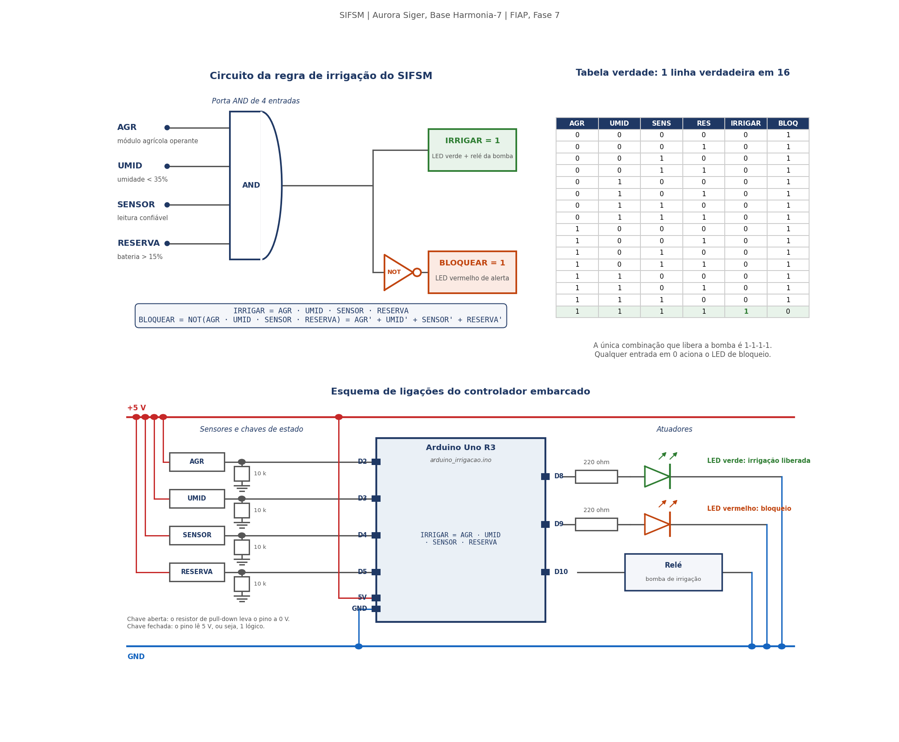
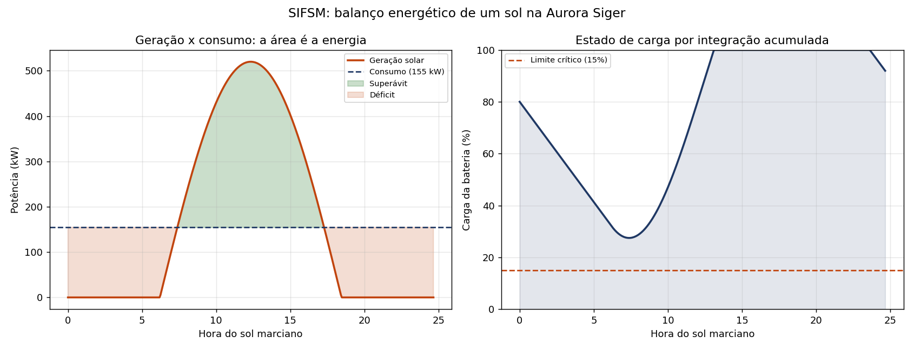
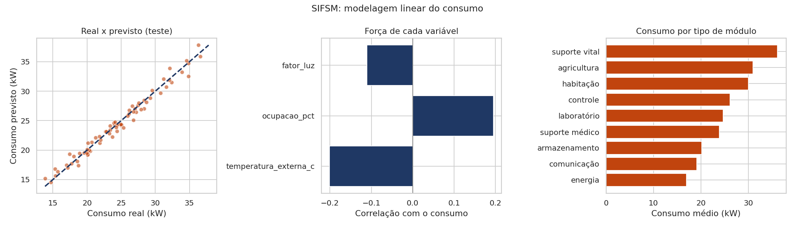
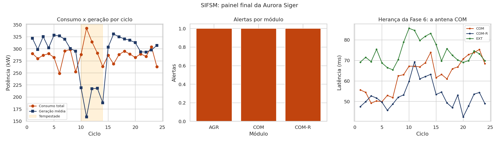

# Relatório Técnico | SIFSM
## Sistema Integrado de Futuro Sustentável em Marte

**Aurora Siger | Base Harmonia-7, Marte**
**FIAP | Ciência da Computação | Fase 7**
**Grupo: Gabriel, Lucas, Matheus, Miguel e Pedro**

---

## 1. Contexto da solução

### 1.1 Continuidade da missão

| Fase | Sistema | O que entregou | O que o SIFSM reaproveita |
|---|---|---|---|
| 4 | SIGIC | Infraestrutura da colônia modelada como grafo | A rede física e as distâncias, hoje na tabela `conexoes` |
| 5 | NCAS | Núcleo cognitivo com JSON, regras booleanas e prompts | O cadastro de módulos e os operadores autorizados |
| 6 | SCIC | Análise de latência e manutenção preditiva | Os três alertas que ficaram abertos |
| **7** | **SIFSM** | **Este sistema** | Leva tudo para banco relacional e acrescenta energia |

A Fase 6 terminou com três recomendações sem resposta: concluir a manutenção da antena do módulo COM, passar o tráfego crítico para o enlace redundante e rever a prioridade cadastral do módulo. O SIFSM começa assumindo as três como alertas ativos no banco, e a prioridade do COM foi corrigida de 3 para 5, atendendo à recomendação anterior.

### 1.2 O problema desta fase

As fases anteriores trataram de comunicação. Esta trata de **sobrevivência com recursos finitos**. A colônia gera energia solar, armazena em bateria e consome em doze módulos. Não existe rede elétrica externa, não existe reposição rápida de peça e cada quilowatt-hora gasto em processamento é um quilowatt-hora a menos para o suporte de vida.

O SIFSM responde a quatro perguntas operacionais:

1. A colônia fecha o dia com saldo de energia positivo?
2. O que precisa ser desligado quando uma tempestade de poeira chegar?
3. Qual decisão pode ser automatizada com segurança e qual exige um humano?
4. Quanto do consumo é previsível a partir do que os sensores medem?

---

## 2. Organização dos dados e banco de dados

### 2.1 Escolha do banco

O banco é **SQLite**, usado pelo módulo `sqlite3` da biblioteca padrão do Python. A escolha tem três motivos: não exige servidor nem instalação, o que permite ao avaliador rodar o projeto com um comando; guarda tudo em arquivo único, que é o modelo adequado a um sistema embarcado de colônia; e usa SQL padrão, então o mesmo `script_banco.sql` roda em Oracle trocando `TEXT` por `VARCHAR2` e `REAL` por `NUMBER`.

A limitação está registrada na seção 11: SQLite não resolve concorrência de escrita, que um Oracle ou PostgreSQL resolveria.

### 2.2 Modelagem

Sete tabelas, com chave primária, chave estrangeira e restrições de domínio:

| Tabela | Registros | Papel |
|---|---|---|
| `modulos` | 12 | Cadastro da colônia, herdado da Fase 5 |
| `conexoes` | 17 | Rede física entre módulos, herdada da Fase 4 |
| `sensores` | 16 | Sensores por módulo, com código hexadecimal |
| `leituras` | 384 | Telemetria de 24 ciclos |
| `alertas` | 3 | Ocorrências abertas, alvo do CRUD completo |
| `manutencoes` | 3 | Histórico de ações, lido como pilha |
| `solicitacoes` | 4 | Pedidos da tripulação, atendidos em fila |

As restrições não são decorativas. `CHECK (prioridade BETWEEN 1 AND 5)` e `CHECK (critico IN (0,1))` barram dado inválido na porta de entrada, e o `PRAGMA foreign_keys = ON` faz o SQLite realmente validar a chave estrangeira, o que ele não faz por padrão.

### 2.3 CRUD e tratamento de erros

As quatro operações estão implementadas sobre a tabela `alertas`, cada uma com tratamento de erro específico:

- **CREATE** (`crud_cadastrar`): separa `sqlite3.IntegrityError`, que indica módulo inexistente ou valor fora do domínio, de `sqlite3.Error`, que cobre qualquer outra falha do banco.
- **READ** (`crud_listar`): consulta com ordenação por situação e criticidade.
- **UPDATE** (`crud_alterar`): valida o nome da coluna contra uma lista fechada antes de montar o SQL. Sem isso, interpolar o nome do campo abriria espaço para injeção.
- **DELETE** (`crud_excluir`): confere `rowcount` para distinguir exclusão bem-sucedida de id inexistente.

A função `criar_banco()` usa o bloco completo `try/except/else/finally`, que separa com clareza quatro situações: arquivo de script ausente, erro de SQL, confirmação da transação e fechamento da conexão, que acontece mesmo se algo falhar no meio.

A opção 2 do menu demonstra quatro tentativas inválidas de propósito:

```
Módulo inexistente  -> FOREIGN KEY constraint failed
Criticidade 7       -> CHECK constraint failed: critico IN (0, 1)
Campo protegido     -> Campo 'codigo_modulo' não pode ser alterado
id inexistente      -> Nenhum alerta com id 9999
```

Nenhuma derruba o programa.

### 2.4 Dados simulados

Além do banco, o sistema exporta `dados_aurora_siger.csv` com 288 linhas (12 módulos × 24 ciclos), que é a base da análise. O processo gerador está documentado na função `gerar_leituras()` e é deliberadamente linear:

```
consumo = consumo_base_do_módulo
        + 0,080 × ocupação (%)
        + 0,120 × (graus abaixo de -20 C lá fora)
        + 6,000 × (1 - fator_de_luz)
        + ruído
```

É essa fórmula que a regressão da seção 6 precisa recuperar sem conhecê-la. Os ciclos 10 a 14 simulam tempestade de poeira, com o fator de luz caindo para a faixa de 0,45 a 0,70. A semente é fixa em 42, então a base é reprodutível, e a opção 11 do menu recria tudo do zero.

---

## 3. Circuitos lógicos, sensores e automação embarcada

### 3.1 A regra

A decisão escolhida é a liberação da irrigação do módulo agrícola. Água e energia são caras em Marte, então a bomba só liga quando quatro condições valem ao mesmo tempo:

```
IRRIGAR = AGR AND UMID AND SENSOR AND RESERVA
```

Onde `AGR` é o módulo em operação, `UMID` é umidade abaixo de 35%, `SENSOR` é leitura confiável e `RESERVA` é bateria acima de 15%.

### 3.2 Simplificação

A operação descreveu a regra de forma redundante, cobrindo um caso que nunca ocorre:

```
IRRIGAR = (AGR · UMID · SENSOR · RESERVA)
          + (AGR · UMID · SENSOR · RESERVA' · 0)
```

Aplicando o elemento absorvente, qualquer produto com 0 vale 0, e depois o elemento neutro da soma, `X + 0 = X`:

```
IRRIGAR = AGR · UMID · SENSOR · RESERVA        (forma mínima)
```

A simplificação que importa de verdade é a da condição de bloqueio, por **De Morgan**:

```
BLOQUEAR = (AGR · UMID · SENSOR · RESERVA)'
         = AGR' + UMID' + SENSOR' + RESERVA'
```

A leitura prática é direta: irrigar exige as quatro condições juntas, mas basta uma falhar para bloquear. É por isso que o circuito usa uma porta AND de quatro entradas para a bomba e um único inversor na saída para o LED de alerta, em vez de quatro comparações separadas.

A função `verificar_equivalencia()` percorre as 16 combinações e confirma que as duas formas concordam, com zero divergências.

### 3.3 Tabela verdade e circuito

Das 16 combinações, apenas `1-1-1-1` libera a bomba. O diagrama está em `graficos_ou_imagens/circuito_logico.png`, em três painéis: a porta AND com o inversor do LED de bloqueio, a tabela verdade completa e o esquema de ligações da placa, com as quatro entradas de um lado e os atuadores do outro.



*Figura 1. Circuito da regra de irrigação, tabela verdade e esquema de ligações. Uma única linha em 16 aciona a bomba.*

Os quatro pinos de entrada e os três de saída desenhados no esquema são exatamente os declarados em `arduino_irrigacao.ino`, de modo que diagrama e código embarcado descrevem a mesma montagem.

### 3.4 Automação embarcada

O arquivo `arduino_irrigacao.ino` implementa a mesma regra para um Arduino Uno, com quatro chaves de entrada, dois LEDs e um relé. Cada entrada usa um resistor de 10 k ohm em pull-down, de modo que a chave aberta leva o pino a 0 V e a fechada entrega os 5 V lidos como 1 lógico. As saídas são dois LEDs com resistor de 220 ohm, nos pinos 8 e 9, e o relé da bomba no pino 10. O monitor serial imprime a tabela verdade completa na inicialização, o que permite verificar que hardware e software concordam.

A decisão de rodar isso na borda e não no servidor central é de arquitetura e de energia ao mesmo tempo: transmitir a leitura por rádio até o centro de controle e esperar a resposta gastaria mais energia do que o microcontrolador gasta para resolver uma porta AND localmente.

---

## 4. Estruturas de dados aplicadas

Cinco estruturas, cada uma escolhida pelo problema que resolve.

### 4.1 Fila: atendimento da tripulação

`FilaSolicitacoes` usa `collections.deque` em duas faixas. Urgência 4 ou 5 entra na fila prioritária, o resto na normal, e dentro de cada faixa vale a ordem de chegada.

A escolha de `deque` em vez de lista comum importa: remover o primeiro elemento de uma lista custa O(n), porque todos os outros são deslocados, enquanto no `deque` custa O(1). Com quatro pedidos a diferença é invisível, mas a estrutura correta é a que não degrada quando a fila crescer.

Por que fila e não ordenação por urgência: ordenar faria um pedido de urgência 2 esperar indefinidamente enquanto chegassem pedidos de urgência 3. A fila por faixas garante que, dentro da mesma urgência, o mais antigo é atendido primeiro.

### 4.2 Pilha: histórico com desfazer

`PilhaHistorico` guarda as ações de manutenção e permite desfazer a partir da mais recente. Desfazer é LIFO por definição: não faz sentido reverter a primeira ação mantendo as que vieram depois, porque elas podem depender dela.

### 4.3 Tabela hash: busca de sensor

`IndiceSensores` indexa os 16 sensores por código. O dicionário do Python é uma tabela hash, então a busca por `0x2A10` não percorre a lista: a função de espalhamento calcula a posição e vai direto ao balde, em O(1) no caso médio.

O método `posicao_hash()` existe para deixar isso visível em tela, mostrando em qual balde a chave cairia. Com 16 sensores a vantagem é teórica; com os milhares de sensores que uma colônia madura teria, é ela que viabiliza a consulta interativa.

### 4.4 Árvore: hierarquia de criticidade

`ArvorePrioridades` organiza os módulos em três níveis: suporte de vida (prioridade 5), operação essencial (4) e apoio e pesquisa (1 a 3). O percurso em profundidade devolve a hierarquia já indentada.

A árvore não está ali por enfeite: o corte de carga desce a hierarquia de baixo para cima, então `folhas_cortaveis()` já devolve a ordem correta de desligamento. A estrutura codifica a política de segurança da colônia.

### 4.5 Grafo: rede física e rota de energia

`GrafoColonia` carrega os 12 vértices e 17 arestas da tabela `conexoes`, herdada da Fase 4, e roda **Dijkstra** para responder por qual caminho a energia deve seguir.

Resultado a partir do módulo ENE, o armazenamento de energia:

| Destino | Distância | Caminho |
|---|---|---|
| OXI | 35 m | ENE → OXI |
| CTR | 40 m | ENE → CTR |
| MED | 45 m | ENE → MED |
| DAT | 75 m | ENE → CTR → DAT |
| COM | 100 m | ENE → CTR → COM |
| COM-R | 125 m | ENE → CTR → COM → COM-R |
| EXT | 675 m | ENE → CTR → COM → COM-R → EXT |

O Dijkstra foi implementado com seleção do menor pendente a cada passo, sem fila de prioridade, para deixar o algoritmo visível. Com 12 vértices o custo é irrelevante; numa rede grande valeria o heap, que foi justamente o que a Fase 6 implementou.

A antena externa a 675 metros é o ponto frágil da rede: qualquer falha em COM ou COM-R a desconecta, porque não existe caminho alternativo.

---

## 5. Simulação computacional e integração matemática

### 5.1 O modelo

A geração solar em um sol marciano (24,65 h) é modelada como meia onda senoidal entre o nascer e o pôr do sol:

```
P(t) = pico × fator_de_poeira × sen(π × (t - nascer) / duração),  se há luz
P(t) = 0,                                                          à noite
```

Com pico de 520 kW e 12,25 h de luz aproveitável.

### 5.2 Três caminhos de integração

A energia gerada é a área sob essa curva. O sistema calcula a mesma integral de três formas independentes:

| Método | Ferramenta | Resultado |
|---|---|---|
| Integração **simbólica** | SymPy, `integrate` | 4055,268 kWh |
| Integração **numérica** | SciPy, `quad` | 4055,268 kWh (erro estimado 1,5e-07) |
| Integração por **trapézios** | NumPy, `trapezoid` | 4055,300 kWh |

A maior divergência é de **0,032 kWh**, ou 0,0008%.

Essa convergência não é enfeite, é validação em dois níveis. A simbólica dá a resposta exata e serve de gabarito. A numérica confirma que o método adaptativo funciona sem conhecer a primitiva. E o trapézio, que é o único método disponível na vida real, porque o sensor entrega pontos discretos e não uma função, prova que **a taxa de amostragem do sensor é suficiente**. Se o sensor medisse de hora em hora, o trapézio se afastaria do gabarito e saberíamos que precisamos de mais amostras.

### 5.3 Média de função e balanço

A **média de função** responde de quanta potência constante a colônia precisaria para gerar a mesma energia:

```
média = (1 / (b - a)) × ∫ P(t) dt = 164,52 kW
```

Balanço do sol, com os módulos ativos consumindo 124,2 kW:

| Grandeza | Valor |
|---|---|
| Energia gerada | 4055,30 kWh |
| Energia consumida | 3061,53 kWh |
| Saldo | +993,77 kWh |
| Carga mínima da bateria | 38,6% |

### 5.4 Estado de carga por integração acumulada

A carga da bateria vem da integral acumulada do saldo:

```
SoC(t) = SoC_inicial + (100 / capacidade) × ∫ (P_gerada - P_consumida) dt
```

Calculada com `cumulative_trapezoid` do SciPy. Enquanto a geração supera o consumo a integral cresce e a bateria carrega; à noite o saldo fica negativo e a carga cai.



*Figura 2. À esquerda, geração e consumo: a área entre as curvas é a energia. À direita, a carga da bateria obtida por integração acumulada.*

### 5.5 Comparação de cenários e a decisão que ela gera

| Cenário | Fator | Energia gerada | Saldo | Carga mínima |
|---|---|---|---|---|
| Céu limpo | 1,00 | 4055,3 kWh | +993,8 kWh | 38,6% |
| Poeira moderada | 0,70 | 2838,7 kWh | −222,8 kWh | 37,3% |
| Tempestade severa | 0,45 | 1824,9 kWh | −1236,6 kWh | 18,2% |

E aqui está o achado principal desta fase. **Hoje a colônia atravessa uma tempestade severa sem cortar nada, com 18,2% de carga mínima. Mas só porque AGR e COM estão em manutenção.**

Quando os dois voltarem a operar, o consumo sobe de 124,2 kW para 154,8 kW, e a mesma tempestade passa a exigir um corte de **29 kW** para manter a reserva acima do piso de 15%. Os módulos de prioridade 2, que são AGR e LAB, somam 34,8 kW e cobrem o corte sem tocar no suporte de vida.

A função `corte_necessario()` chega a esse número reduzindo o consumo de 1 em 1 kW e refazendo a simulação até a carga mínima subir acima do alvo. A folga de hoje é consequência de uma avaria, não de projeto, e esse é exatamente o tipo de conclusão que só aparece simulando.

### 5.6 Convolução aplicada ao sensor

O alerta herdado da Fase 5 dizia que o sensor de umidade do AGR tinha leitura instável. Em vez de substituir o equipamento, o sistema convolui a série com um núcleo retangular de média móvel:

| Medida | Valor |
|---|---|
| Desvio padrão bruto | 9,38 |
| Desvio padrão filtrado | 4,35 |
| Redução de ruído | 53,6% |

Resolver por software economiza a peça e, mais caro que a peça, o transporte dela da Terra.

---

## 6. Modelagem linear e tomada de decisão

### 6.1 O modelo

Regressão linear **múltipla** estimando o consumo de um módulo a partir de quatro variáveis, com divisão de 216 linhas de treino e 72 de teste:

```
consumo_kw ~ consumo_base_kw + ocupacao_pct + temperatura_externa_c + fator_luz
```

| Métrica | Valor |
|---|---|
| MAE | 0,677 kW |
| RMSE | 0,841 kW |
| R² | 0,9768 |

### 6.2 Interpretação dos coeficientes

| Variável | Coeficiente | Valor real do gerador | Leitura física |
|---|---|---|---|
| `consumo_base_kw` | +1,006 | +1,000 | cada kW cadastrado soma 1 kW ao total |
| `ocupacao_pct` | +0,080 | +0,080 | cada 1% de ocupação soma 0,080 kW |
| `temperatura_externa_c` | −0,123 | −0,120 | cada grau a mais lá fora economiza 0,123 kW de aquecimento |
| `fator_luz` | −5,833 | −6,000 | céu limpo economiza 5,8 kW frente ao escuro total |

O modelo recuperou os quatro pesos a partir dos dados, sem conhecer a fórmula. É isso que confirma que a regressão capturou a física do problema e não uma coincidência amostral.

### 6.3 O fator que prejudicaria a interpretação

Uma versão anterior do modelo incluía `prioridade` entre as variáveis e produzia um coeficiente **negativo** para ela, sugerindo o absurdo de que módulo mais crítico consome menos.

A causa é **colinearidade**: no gerador, a ocupação média depende da prioridade, e as duas têm correlação de +0,387. Com as duas no modelo, o efeito se divide entre elas de forma arbitrária e os coeficientes perdem leitura física, mesmo com o R² alto.

A solução foi tirar `prioridade` e manter `consumo_base_kw`, que já carrega a mesma informação de forma direta e interpretável. O episódio ilustra o ponto que o enunciado pede: um modelo com bom ajuste pode ter coeficientes que não significam nada, e verificar isso faz parte da modelagem.



*Figura 3. Real contra previsto no teste, força de cada variável e consumo médio por tipo de módulo.*

### 6.4 A decisão que o modelo apoia

Para o cenário de tempestade severa no módulo OXI, com ocupação de 80%, temperatura externa de −78 C e fator de luz 0,45, o modelo estima **41,35 kW** de consumo. Esse número alimenta o cálculo de corte de carga da seção 5: é o consumo que a colônia precisa cobrir no pior cenário previsto, e não a média confortável do dia a dia.

---

## 7. Integração de IA e sistemas multiagentes

### 7.1 Arquitetura

```
solicitação
    ↓
[GUARDRAIL DE ENTRADA]   bloqueia ordem irreversível, operação destrutiva e assunto fora de escopo
    ↓
[AGENTE TRIADOR]         classifica o domínio por palavras-chave e pontuação
    ↓
[HANDOFF]                repassa ao especialista com o contexto da sessão
    ↓
[AGENTE ESPECIALISTA]    energia, ambiental, manutenção ou dados
    ↓                    chama FERRAMENTAS determinísticas sobre o banco
[RAG]                    recupera registros que fundamentam a resposta
    ↓
[GUARDRAIL DE SAÍDA]     exige fonte no banco antes de liberar
    ↓
resposta + rastro completo da decisão (tracing)
```

### 7.2 Por que determinístico e não um modelo de linguagem

A camada não chama API externa. As respostas são montadas por funções que consultam o banco, e a escolha tem três razões:

1. **Energia.** Um modelo de linguagem rodando continuamente competiria por quilowatt-hora com a produção de oxigênio. A seção 9 desenvolve esse ponto.
2. **Verificabilidade.** Todo número da resposta sai de uma consulta SQL que o operador pode repetir. Não existe alucinação possível.
3. **O que o enunciado pede.** O exercício é demonstrar a arquitetura de agentes: triagem, handoff, ferramentas, guardrails e sessão. Essa arquitetura é idêntica com ou sem modelo de linguagem no lugar das funções de resposta.

A limitação está registrada na seção 11: o sistema não interpreta linguagem livre, depende de palavras-chave.

### 7.3 Guardrails com nuance

O guardrail de entrada distingue **pergunta** de **ordem**, o que é a parte não trivial:

| Entrada | Decisão | Motivo |
|---|---|---|
| "o que podemos desligar?" | liberado | é consulta, e recomendar é a função do sistema |
| "Desligue o módulo de oxigênio agora" | bloqueado | é ordem de ação irreversível |
| "drop table alertas" | bloqueado sempre | operação destrutiva, nem em forma de pergunta |
| "Me conta uma piada sobre Marte" | bloqueado | fora do escopo operacional |

Sem essa distinção, o sistema bloquearia a pergunta mais útil que o operador pode fazer antes de uma tempestade. O guardrail de saída exige que toda resposta cite ao menos um registro do banco.

### 7.4 Exemplo de atendimento completo

Para a pergunta "Qual o consumo de energia da colônia e o que podemos desligar?", o rastro foi:

```
guardrail_entrada  -> liberado (cita ação, mas na forma de consulta)
agente_triador     -> energia (2 termos reconhecidos)
handoff            -> Agente de Energia
ferramentas        -> consumo_por_modulo
guardrail_saida    -> liberado (fundamentada em 1 registro)
```

E a resposta citou os 124,2 kW dos módulos ativos, os três maiores consumidores e os 13,8 kW cortáveis sem afetar suporte de vida, todos vindos da tabela `modulos`.

---

## 8. Arquitetura computacional e desempenho

### 8.1 Onde cada parte roda melhor

| Etapa do SIFSM | Unidade | Motivo |
|---|---|---|
| Consultas SQL e CRUD | CPU | trabalho sequencial, dominado por acesso a disco |
| Integração numérica | CPU/GPU | vetorizável, cada ponto é independente |
| Regressão linear | CPU | matriz pequena, resolvida direto por álgebra |
| Dijkstra sobre o grafo | CPU | cada passo depende do anterior, não paraleliza bem |
| Convolução do sensor | GPU/NPU | mesma operação repetida sobre toda a série |
| Inferência de IA real | NPU/TPU | multiplicação de matrizes em lote |

### 8.2 Hierarquia de memória e o gargalo real

O banco tem 384 leituras, algumas centenas de kilobytes. A base inteira cabe na RAM e boa parte cabe no cache L2, então o gargalo do SIFSM **não é cálculo, é acesso a disco**. É por isso que `script_banco.sql` cria índices em `codigo_sensor` e `ciclo`: eles reduzem as páginas lidas por consulta.

Quando a colônia crescer para milhões de leituras, o custo passa a ser o transporte entre memória e processador, e não a operação em si. Esse é o gargalo de von Neumann, e a resposta não é processador mais rápido: é mover menos dado, agregando no próprio banco e usando colunas numéricas compactas.

### 8.3 Largura de banda e arquiteturas modernas

Uma consulta que varre as 384 leituras move cerca de 30 KB. Um SSD entrega algo como 500 MB/s e a RAM passa de 20 GB/s, quarenta vezes mais. Enquanto o dado cabe na memória, a largura de banda sobra e o processador espera o disco. Com milhões de registros a conta inverte: o processador calcula mais rápido do que a memória entrega, e a largura de banda vira o teto do sistema, não a frequência da CPU.

**ASICs.** Um circuito desenhado para uma função só. A regra de irrigação é o exemplo perfeito: uma porta AND de quatro entradas em hardware dedicado gastaria uma fração do que gasta um microcontrolador de uso geral rodando o mesmo `if`. O custo é a rigidez, porque mudar o limite de umidade de 35% para 40% exigiria refazer o chip, enquanto no Arduino é uma linha.

**Chiplets.** Blocos menores montados num mesmo encapsulamento, em vez de um chip único e grande. Para a colônia o atrativo é logístico: um bloco defeituoso pode ser trocado sem substituir o processador inteiro, o que pesa quando a peça de reposição vem da Terra.

**Paralelismo.** A simulação avalia a potência em 400 instantes do sol, e cada ponto é independente. Isso é paralelismo de dados, que o NumPy já resolve vetorizado e uma GPU dividiria entre milhares de núcleos. O Dijkstra é o oposto, porque cada passo depende do anterior, então nenhum hardware paralelo ajudaria. Distinguir os dois casos é o que evita comprar aceleração que não será usada.

### 8.4 Computação heterogênea e processamento na borda

A regra de irrigação é uma porta AND de quatro entradas. Resolver isso num microcontrolador de poucos miliwatts, no próprio módulo agrícola, custa menos energia do que transmitir a leitura por rádio até o centro de controle e esperar a resposta.

Distribuir tarefa entre unidade adequada é computação heterogênea; aqui ela também é decisão de sustentabilidade, porque o rádio é um dos maiores consumidores de energia de um nó remoto.

### 8.5 Desempenho, energia e sustentabilidade

Toda operação computacional sai do mesmo orçamento solar que abastece o suporte de vida. Com a margem de 993 kWh por sol apurada na seção 5, um modelo de IA grande rodando continuamente consumiria parte relevante dessa folga. Foi por isso que a camada de IA usa funções determinísticas: entrega resposta auditável com consumo praticamente nulo.

---

## 9. Sustentabilidade, cidadania digital e impacto socioambiental

**Integração entre energia, dados, automação e simulação.** A colônia gera 4055 kWh por sol em céu limpo e consome 3062 kWh. A margem parece confortável, mas depende de dois módulos estarem parados. É essa estreiteza que obriga a integrar as camadas: o sensor mede, o banco guarda, a regra decide e a simulação antecipa. Sem integração, a colônia só descobriria o problema com a bateria já baixa.

**Simulação como prevenção de desperdício.** Descobrir que o pleno operacional exige 29 kW de corte custou zero energia. Descobrir isso durante a tempestade custaria um desligamento de emergência, com risco ao suporte de vida. Simular é mais barato que errar, e essa é a justificativa econômica da seção 5 inteira.

**Redes inteligentes, armazenamento e resiliência.** A autonomia da colônia depende de três camadas trabalhando juntas: a física, que são painéis, bateria e cabos; a de controle, que é a regra booleana decidindo dentro do módulo agrícola; e a analítica, que é o banco com a simulação e o modelo. Resiliência aqui tem nome e número: COM e COM-R formam um par redundante, assim como DAT e BKP, mas a antena EXT está a 675 metros por um caminho único, então uma falha em COM-R a desconecta. O grafo expõe essa fragilidade antes que ela vire incidente, e é isso que uma rede inteligente faz: conhece a própria topologia.

**Inovação responsável: benefício contra risco.** Nem toda tecnologia disponível deveria entrar na colônia, e o SIFSM recusou duas de propósito. Um modelo de linguagem rodando local daria respostas mais naturais, mas consumiria energia do mesmo orçamento do suporte de vida e responderia sem fonte verificável; ficaram as funções determinísticas. Automatizar o desligamento de módulos durante a tempestade seria mais rápido que esperar aprovação humana, e é tecnicamente trivial, mas um erro de sensor desligaria oxigênio sem ninguém no circuito. Inovação responsável é avaliar o que a tecnologia custa e o que ela arrisca, não apenas o que ela entrega.

**Cidadania digital, privacidade e transparência.** A tabela `solicitacoes` guarda quem pediu o quê, o que é dado pessoal da tripulação. O SIFSM registra apenas o identificador funcional (`CMDT_SILVA`, `ENG_ROCHA`, `MED_ALVES`), nunca dado de saúde, e as solicitações ao suporte médico guardam só módulo e urgência, sem descrever a condição de quem pediu. Do lado da transparência, toda resposta da camada de IA cita o registro que a fundamenta e exibe o rastro completo da decisão.

**Economia dos dados e seus riscos.** Consumo por módulo revela rotina de vida: quando a tripulação dorme, quando o laboratório trabalha, quantas pessoas estão em cada setor. Numa colônia de poucas dezenas de pessoas, isso identifica indivíduos mesmo sem nome na tabela. Por isso a ocupação é gravada como percentual agregado por módulo, e não como registro de presença individual. Essa é uma decisão de modelagem tomada por motivo de privacidade, não de conveniência técnica.

**Impacto ambiental do processamento.** Data centers consomem água e energia. Em Marte os dois são recursos que não se repõem. Processar na borda, usar banco local em arquivo e evitar modelo pesado não é economia de código: é economia de litro de água e de quilowatt-hora que o suporte de vida vai precisar.

**Diversidade, inclusão e responsabilidade.** A fila ordena por urgência declarada e ordem de chegada, nunca por cargo de quem pediu. A árvore classifica módulos por função vital, não por importância das pessoas que os ocupam. São escolhas de projeto que impedem o sistema de reproduzir hierarquia social na distribuição de recurso escasso. E toda recomendação crítica passa por validação humana, porque responsabilidade por decisão que afeta vidas não é delegável a software.

---

## 10. Resultados consolidados



*Figura 4. Consumo contra geração por ciclo com a janela de tempestade, alertas por módulo e a latência do COM herdada da Fase 6.*

| Indicador | Valor |
|---|---|
| Módulos cadastrados | 12 |
| Leituras no banco | 384 |
| Alertas em aberto | 3, sendo 1 crítico |
| Consumo dos módulos ativos | 124,2 kW |
| Energia gerada por sol | 4055 kWh |
| Saldo em céu limpo | +994 kWh |
| Corte exigido hoje na tempestade | 0 kW |
| Corte exigido no pleno operacional | 29 kW |
| Modelo de consumo | R² 0,9768, MAE 0,68 kW |
| Convergência das três integrações | 0,0008% |

### Recomendações do SIFSM

1. Planejar o corte de 29 kW para quando AGR e COM voltarem ao pleno. AGR e LAB somam 34,8 kW e cobrem o corte sem tocar no suporte de vida.
2. Concluir a manutenção da antena COM, pendente desde a Fase 5, mantendo o tráfego crítico no enlace redundante até lá.
3. Aplicar o filtro de convolução ao sensor de umidade do AGR em vez de substituir o equipamento.
4. Tratar as três recomendações acima como sugestões: a validação é da equipe da colônia.

---

## 11. Limitações e possíveis melhorias

**Limitações.** Os dados são simulados por um processo conhecido e linear, o que favorece a regressão; com telemetria real o R² seria menor. A simulação energética trata o consumo como constante ao longo do sol e ignora perdas de conversão, temperatura do painel e inclinação do terreno. A camada de IA usa funções determinísticas, então demonstra a arquitetura de agentes mas não interpreta linguagem livre. O banco é SQLite em arquivo único, sem concorrência de escrita. O circuito lógico é representado em diagrama e implementado em código embarcado, sem hardware real montado nem simulação eletrônica rodando.

**Melhorias.** Registrar o consumo por hora em vez de por ciclo, o que permitiria modelar a curva de carga e não apenas a média. Migrar para Oracle ou PostgreSQL quando houver mais de um operador escrevendo ao mesmo tempo. Substituir as funções de resposta por um modelo de linguagem pequeno rodando localmente, mantendo os mesmos guardrails e ferramentas. Acrescentar previsão meteorológica ao modelo, para antecipar o fator de poeira em vez de reagir a ele. Fechar o ciclo com as fases anteriores, exportando os alertas priorizados de volta ao formato JSON do NCAS. E montar o circuito em hardware real, validando o consumo medido do microcontrolador contra a estimativa da seção 8.

---

## 12. Conclusão

O SIFSM integra, num protótipo executável, as sete frentes que a fase pede: banco relacional com CRUD e tratamento de erros, regra booleana implementada em software e em circuito, cinco estruturas de dados escolhidas pelo problema que resolvem, simulação com integração simbólica, numérica e por trapézios, regressão linear múltipla com coeficientes interpretáveis, arquitetura de agentes com guardrails e análise de arquitetura computacional conectada ao consumo energético.

O resultado técnico mais sólido é a convergência das três integrações em 0,0008%, que valida de uma vez o modelo e a taxa de amostragem do sensor, e o modelo linear recuperando os quatro pesos reais do gerador.

Mas o resultado que justifica o sistema é outro: **a colônia só atravessa uma tempestade severa hoje porque dois módulos estão avariados.** Quando AGR e COM voltarem ao pleno, a mesma tempestade exige cortar 29 kW. A folga atual é consequência de um defeito, não de projeto, e nenhuma leitura isolada de sensor mostraria isso. Foi preciso o banco guardar o histórico, a simulação projetar o cenário e o modelo estimar o consumo no pior caso para que a conclusão aparecesse.

É o mesmo padrão que a Fase 6 encontrou com a antena: o número confortável esconde o problema, e só o cruzamento de ferramentas revela. Por isso o SIFSM permanece como sistema de apoio, com a decisão final sob responsabilidade da equipe da Aurora Siger.

---

*Aurora Siger. Exploramos dados. Construímos soluções. Geramos impacto para o amanhã em Marte.*
